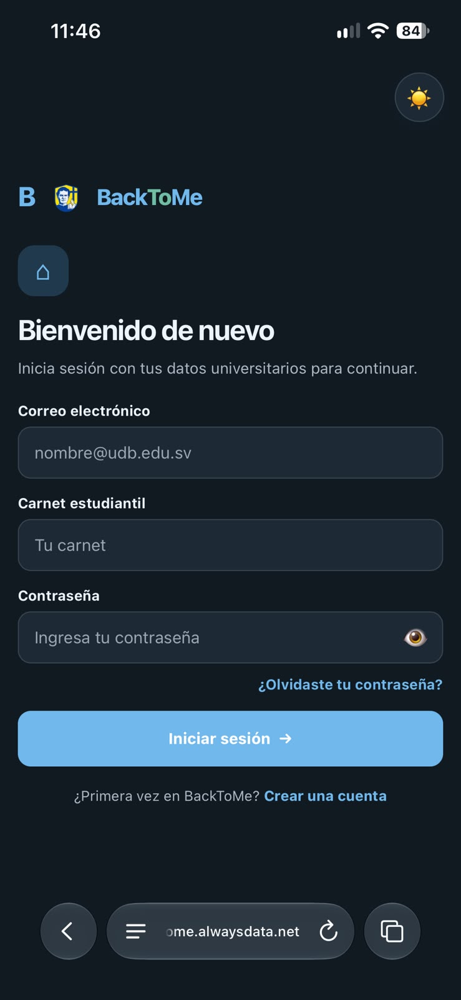
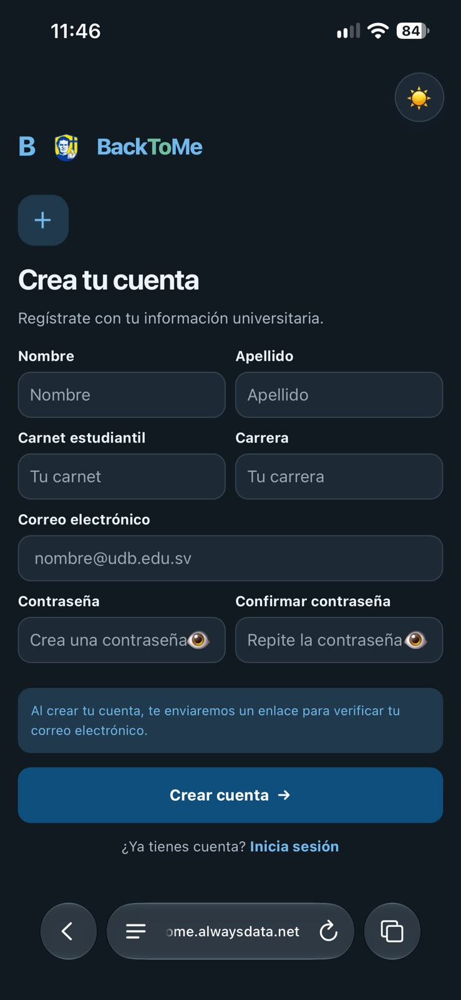
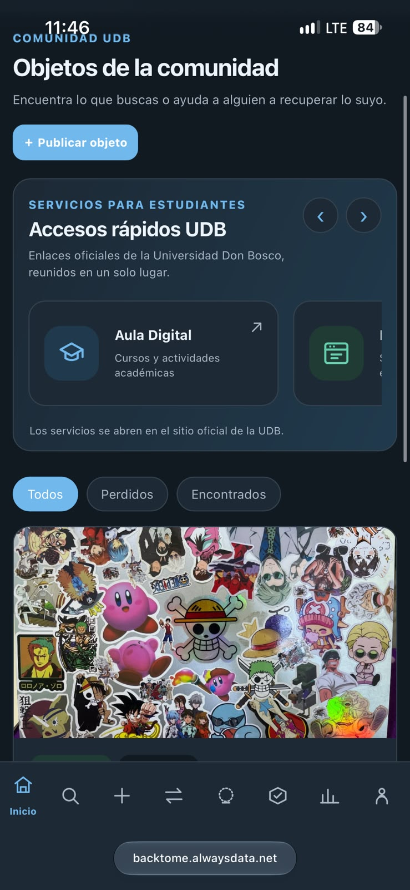
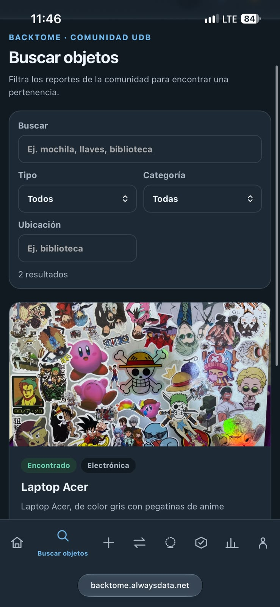
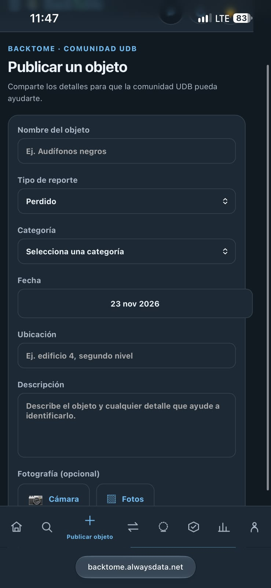
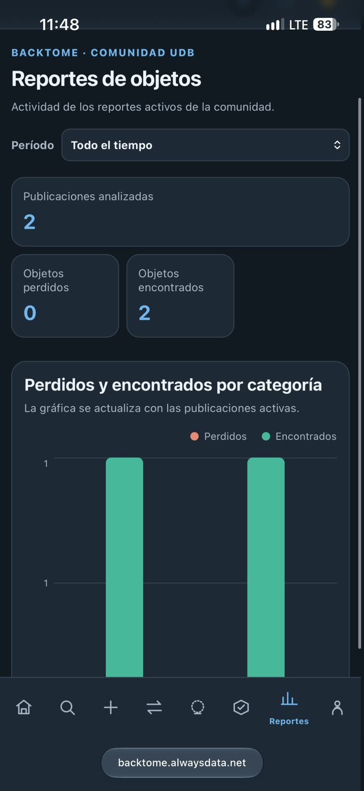
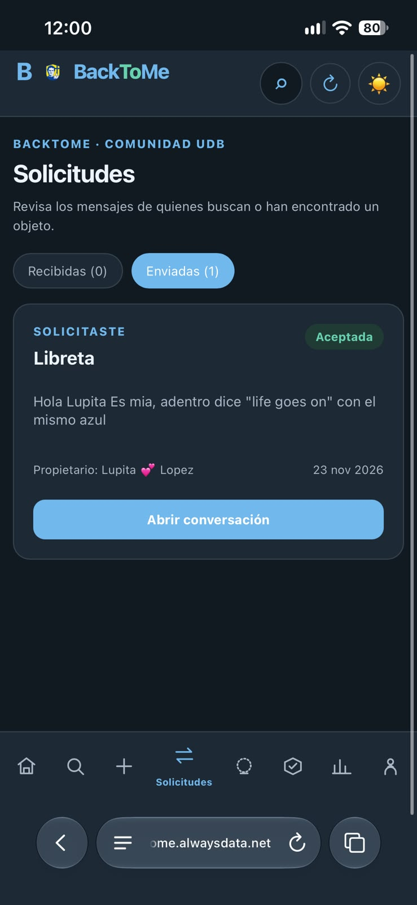

# BackToMe — objetos perdidos y encontrados UDB

BackToMe es una aplicación web para que la comunidad de la Universidad Don Bosco publique, busque y gestione reportes de objetos perdidos y encontrados.

## Licencias

- El código fuente propio del proyecto se publica bajo la licencia [MIT](LICENSE).
- La documentación y los materiales originales que no son código se comparten bajo [Creative Commons Atribución 4.0 Internacional (CC BY 4.0)](LICENSE-CONTENIDO.md).
- Las licencias de las dependencias, marcas, logotipos y materiales de terceros no cambian; consulta sus avisos originales.

## Aporte individual y trabajo del equipo

### Mi aporte individual: integración de Cloudinary

Integré Cloudinary para almacenar las fotografías adjuntas a los reportes de objetos. Al publicar un objeto, el servidor valida la imagen y la envía a Cloudinary mediante su API de carga. La base de datos guarda la URL segura que devuelve el servicio, y la aplicación utiliza esa URL para mostrar la foto.

La solicitud a Cloudinary se realiza desde el servidor. La clave secreta no se expone en React ni en el navegador. Si Cloudinary no está configurado, el servidor conserva el mecanismo local anterior para guardar la foto en la base de datos.

### Framework del proyecto: React

El equipo eligió React 19, Vite y React Router para toda la interfaz de usuario. El acceso, registro, recuperación de contraseña y los módulos internos (inicio, búsqueda, publicación, solicitudes, mensajes, reportes y perfil) están integrados en rutas y componentes React que consumen la API del servidor. Node.js/Express y MySQL siguen encargándose de los datos y la lógica del servidor.

## Funciones principales

- Registro con nombre, apellido, carnet, carrera, correo y contraseña.
- Verificación del correo electrónico antes de iniciar sesión.
- Inicio de sesión y manejo de sesiones mediante la API del servidor.
- Publicación y búsqueda de objetos perdidos y encontrados, con foto, categoría, descripción, ubicación y fecha.
- Gestión de publicaciones propias.
- Envío y respuesta a solicitudes, y conversación entre participantes.
- Marcar objetos encontrados como entregados después de aceptar una solicitud, consultar las devoluciones y dejar una reseña pública como persona receptora.
- Editar desde el perfil todos los datos de una publicación (incluida su foto) o eliminarla; los reportes entregados no aparecen entre los objetos activos.
- Módulo de reportes con una gráfica dinámica de objetos perdidos y encontrados por categoría.
- Accesos rápidos de la UDB en la página de inicio, junto a la vista previa de publicaciones.
- Interfaz adaptable, con tema claro y oscuro.

### Accesos rápidos UDB

La página de inicio presenta los objetos de la comunidad y agrega un carrusel adaptable con accesos a Aula Digital, Portal Web, Biblioteca, Repositorio Digital, UDB Virtual y Publicaciones, siguiendo los servicios que muestra el sitio oficial. Los controles permiten recorrer tarjetas amplias con iconos ilustrativos en pantallas grandes y pequeñas. Cada enlace abre el destino oficial en una pestaña nueva.

### Módulo de reportes

La opción **Reportes** del menú muestra los totales de objetos perdidos y encontrados y una gráfica dinámica por categoría. La gráfica se genera a partir de los objetos que el servidor entrega a la sesión actual y permite filtrar por período. Está dibujada en la interfaz y no requiere una conexión adicional para graficar.

## Tecnologías

- **Frontend:** React, React Router y Vite.
- **Servidor:** Node.js y Express.
- **Base de datos:** MySQL/MariaDB, conectada con `mysql2`.
- **Fotos:** API de carga de imágenes de Cloudinary.
- **Correo:** Nodemailer para verificación de cuentas.

## Carpetas y archivos

- `react-app/`: aplicación React, rutas, páginas, componentes reutilizables y estilos de los módulos.
- `server.js`: servidor Express, endpoints, conexión a base de datos y carga segura de imágenes a Cloudinary.
- `js/` y `css/`: archivos heredados conservados para referencia; la interfaz que ejecuta Vite ahora usa React.
- `database/`: migraciones SQL para los campos del registro, sesiones y fotos.
- `documentacion/`: documento de investigación sobre las librerías JavaScript.
- `imagenes.img/`: recursos gráficos del proyecto.
- `.env.example`: plantilla de configuración sin credenciales reales.

## Configuración local

Se necesita Node.js 18 o posterior, npm y MySQL80 iniciado en el puerto `3306`, con la base `backtome` creada. Para este uso local, el servidor Node se conecta directamente a MySQL80; deja detenido el módulo MySQL de XAMPP para que no intente ocupar el mismo puerto. Apache de XAMPP puede seguir activo si utilizas su phpMyAdmin.

1. Copia el `.env.example` de la carpeta raíz como `.env`. En ese archivo configura una sola conexión local: `DB_HOST=127.0.0.1`, `DB_PORT=3306`, `DB_USER=root`, `DB_PASSWORD` con tu clave de MySQL80 y `DB_NAME=backtome`. Conserva esa configuración mientras trabajes con MySQL80. No subas `.env` a GitHub.
2. Instala las dependencias desde la carpeta raíz:

   ```bash
   npm install
   ```

3. Si la base todavía no tiene los campos y la tabla de sesiones requeridos, pide a una cuenta con permisos administrativos que ejecute, en la base `backtome`, `database/auth-migration.sql` y `database/contenido-migration.sql`. Para esta versión, ejecuta también una sola vez `database/entregas-resenas-migration.sql`. No vuelvas a ejecutar migraciones ya aplicadas.
4. Inicia el backend en una terminal:

   ```bash
   npm start
   ```

5. Inicia React en otra terminal:

   ```bash
   npm run dev
   ```

6. Abre `http://localhost:5173/login`.

## Variables de entorno

El `.env` de la carpeta raíz configura el servidor y la base MySQL80. El archivo `react-app/.env` solo indica a Vite la dirección de la API; no contiene otra conexión a MySQL.

`.env.example` indica las variables necesarias:

- `DB_HOST`, `DB_PORT`, `DB_USER`, `DB_PASSWORD` y `DB_NAME` para MySQL/MariaDB.
- `SMTP_USER` y `SMTP_APP_PASSWORD` para enviar el correo de verificación.
- `CLOUDINARY_CLOUD_NAME`, `CLOUDINARY_API_KEY` y `CLOUDINARY_API_SECRET` para guardar las fotos en Cloudinary.
- `PORT`, `APP_BASE_URL`, `APP_FRONTEND_URL` y `CORS_ORIGIN` para las direcciones de la aplicación y su API.
- `NODE_ENV` para activar la publicación de React desde Express en producción.

La plantilla usa `root` solo como opción práctica para la base local de la demostración. La clave real se escribe en `.env`, que está excluido mediante `.gitignore`; no compartas ni subas ese archivo. En un despliegue público debe configurarse un usuario de base de datos con permisos limitados, no `root`.

## Publicar una demostración en Internet

La app necesita publicar React, ejecutar la API Node/Express y conectarse a MariaDB/MySQL. Una plataforma para sitios estáticos por sí sola no basta. Para una demostración gratuita se preparó el proyecto para Alwaysdata, que ofrece Node.js, MariaDB y una dirección HTTPS `*.alwaysdata.net`.

> La modalidad gratuita de Alwaysdata tiene límites de recursos (1 GB de disco y 256 MB de RAM), permite únicamente la dirección `*.alwaysdata.net` y detiene el proceso web después de un período sin visitas; al volver a entrar puede tardar un poco en iniciar. Está pensada para pruebas y demostraciones, no para garantizar disponibilidad continua. Revisa las condiciones vigentes del proveedor antes de registrarte.

### Preparar la base de datos en Alwaysdata

1. Crea una cuenta y una cuenta de alojamiento de Alwaysdata. Anota el nombre de cuenta que forma parte de tu dirección pública, por ejemplo `mi-cuenta.alwaysdata.net`.
2. En **Databases > MySQL**, crea una base de datos y un usuario con permisos sobre esa base. Guarda el nombre de la base, usuario y contraseña que muestre el panel.
3. Abre phpMyAdmin desde el panel, selecciona la base nueva e importa `database/schema-hosting.sql`. Este esquema crea las diez tablas de la versión final dentro de la base seleccionada y no requiere ejecutar las migraciones antiguas.

### Subir y construir la aplicación

1. Sube el contenido del repositorio a tu cuenta de alojamiento mediante Git/SSH o SFTP. No subas el archivo `.env`.
2. En una terminal SSH, entra a la carpeta raíz del proyecto y ejecuta:

   ```bash
   npm install
   npm run build
   ```

3. En **Environment > Node.js**, selecciona Node.js 20 o 22 LTS.
4. En **Web > Sites**, crea un sitio de tipo **Node.js** con la dirección `mi-cuenta.alwaysdata.net`. Configura la carpeta del proyecto como directorio de trabajo y el comando `node server.js`. El sitio proporciona las variables `IP` y `PORT` para que Express escuche detrás del proxy HTTPS.

### Variables privadas en el panel de Alwaysdata

En la configuración del sitio Node.js agrega estas variables. Reemplaza los valores entre `< >` por los valores reales del panel; no uses las llaves `<>` literalmente.

```text
NODE_ENV=production
DB_HOST=mysql-<nombre-de-cuenta>.alwaysdata.net
DB_PORT=3306
DB_USER=<usuario-de-la-base>
DB_PASSWORD=<clave-de-la-base>
DB_NAME=<nombre-de-la-base>
SMTP_USER=<correo-de-BackToMe>
SMTP_APP_PASSWORD=<clave-de-aplicacion-de-Gmail>
APP_BASE_URL=https://<nombre-de-cuenta>.alwaysdata.net
APP_FRONTEND_URL=https://<nombre-de-cuenta>.alwaysdata.net
CORS_ORIGIN=https://<nombre-de-cuenta>.alwaysdata.net
```

La dirección exacta del servidor MySQL debe copiarse del panel de Alwaysdata. Configura también las tres variables de Cloudinary si quieres guardar las fotos fuera de MySQL. Las claves se agregan solo al panel de alojamiento; nunca se publican en el repositorio.

Para evidenciar el requisito de consumo de una API externa, configura Cloudinary en el alojamiento y muestra en la defensa cómo una foto publicada se envía mediante su API y queda asociada al objeto. Sin las variables de Cloudinary, BackToMe conserva la foto en MySQL y no usa Cloudinary para esa publicación.

Tras guardar las variables, reinicia el sitio Node.js. React y la API se sirven desde la misma dirección. Comprueba la página pública, el registro con correo, el inicio de sesión, la carga de objetos, la imagen, la edición, la solicitud y el correo de recuperación usando cuentas de demostración.

### Dirección pública

- URL publicada: [https://backtome.alwaysdata.net](https://backtome.alwaysdata.net)
- Proveedor: Alwaysdata (modalidad gratuita de demostración).
- Repositorio público: [https://github.com/krivera-udb/BackToMe](https://github.com/krivera-udb/BackToMe)

Actualiza esta sección con la dirección definitiva después de desplegar y probar el sitio.

## Capturas de la aplicación en móvil

Estas capturas muestran cómo se adapta BackToMe a una pantalla de teléfono. Se incluyen las pantallas de acceso, registro, inicio, búsqueda, publicación, solicitudes y reportes.

<table>
  <tr>
    <td align="center"><br><sub>Inicio de sesión</sub></td>
    <td align="center"><br><sub>Registro</sub></td>
    <td align="center"><br><sub>Inicio y navegación móvil</sub></td>
  </tr>
  <tr>
    <td align="center"><br><sub>Buscar objetos</sub></td>
    <td align="center"><br><sub>Publicar un objeto</sub></td>
    <td align="center"><br><sub>Reportes y gráfica</sub></td>
  </tr>
  <tr>
    <td colspan="3" align="center"><br><sub>Solicitudes y botón para abrir la conversación</sub></td>
  </tr>
</table>

